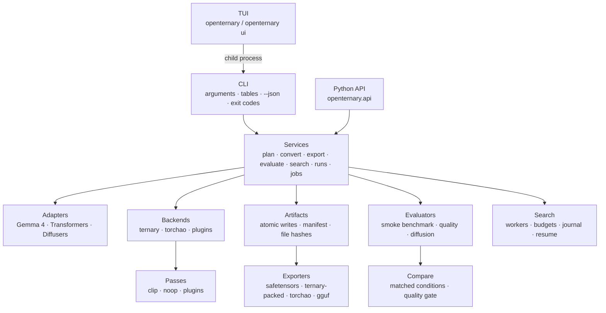

# Architecture

OpenTernary keeps three concerns independent, so that each can change without rewriting the others:

```text
model architecture   ×   quantization method   ×   evaluation / export
   (adapters)              (backends, passes)       (evaluators, exporters)
```

Adding a model should not require new quantization maths, and adding a quantization method should not require
new model code.

## Layers



| Layer | Package | Responsibility |
|---|---|---|
| **CLI** | `openternary.cli` | Parses arguments, prints tables or one JSON document, maps errors to exit codes. Holds no logic of its own. |
| **TUI** | `openternary.ui.app` | Builds forms from the CLI definition and runs every job as `python -m openternary …` in a child process. |
| **Python API** | `openternary.api` | A stable, version-1 entry point to the same services. Importing it never loads PyTorch. |
| **Services** | `openternary.services` | Planning, conversion, export, evaluation, search, run discovery, job management, PyTorch setup, updates. Shared by the CLI and the API. |
| **Adapters** | `openternary.adapters` | Recognize a model or pipeline component, classify each tensor (quantizable or not, and its role) and load it at runtime. Unknown weights are never assumed to be quantizable. |
| **Backends** | `openternary.backends` | A quantization method: `ternary` (OpenTernary's own maths) or `torchao` (TorchAO 0.18.0). |
| **Quant core** | `openternary.quant` | The maths: AbsMean, grouping, thresholds, soft codes, 2-bit packing, bit accounting, the bounded sharded writer. |
| **Calibration** | `openternary.calibration` | Activation capture, layer-local optimization, checkpoints, recovery, preflight. |
| **Evaluation** | `openternary.benchmark` | The smoke suite, quality datasets and perplexity, the acceptance gate. |
| **Experiment** | `openternary.experiment` | Run directories, metadata, run locks, run comparison. |
| **Export** | `openternary.export` | Packed format, GGUF bridge. |

## Design decisions worth knowing

**Header-only by default.** `inspect` and `plan` read only safetensors headers and `config.json`. They work
without PyTorch, without a GPU and without downloading weights. The bit-accounting code uses only the standard
library for the same reason.

**Bounded memory when writing.** Quantized snapshots are written tensor by tensor into shards of at most 512 MiB.
A shard is flushed *before* a tensor that would overflow it is added, and a single tensor larger than that gets a
shard of its own. Memory use is bounded by the largest tensor plus one shard, never by the size of the model.
Hugging Face cache symlinks are dereferenced, so a snapshot is self-contained.

**Atomic artifacts.** Every export is written into a unique temporary directory, validated, and only then moved
to its final name. An existing artifact is never overwritten. A manifest (`openternary-manifest.json`) records
the format, schema, provenance, configuration, backend, adapter, passes, code hash and the SHA-256 of every file,
and is carried forward on re-export.

**Content fingerprints.** A snapshot's identity is a hash of its sorted tensor names, dtypes, shapes and raw
bytes. File hashes are recorded as well, but two snapshots with the same content have the same fingerprint even
if their shard layout differs.

**Device honesty.** Snapshot conversion runs on the CPU. `--device cuda` for `quantize` is rejected rather than
silently falling back to the CPU, and a GPU evaluation that fails is never replaced by a CPU result.

**Plugins load only when chosen.** Listing plugins (`openternary plugins`, `backends list`) reads entry-point
metadata without importing plugin code. A plugin is imported only when you select it by name. See
[Plugins](../reference/plugins.md).

**Lazy imports.** `--json` code paths never import the TUI library, and the core install never imports PyTorch,
so the CLI starts quickly and works in minimal environments.

## Further reading

The maintained design documents live in the repository:

- [ARCHITECTURE.md](https://github.com/ELRdn/OpenTernary/blob/main/ARCHITECTURE.md): data flow, adapter and
  quantizer contracts, tensor representations
- [docs/TUI_DESIGN.md](https://github.com/ELRdn/OpenTernary/blob/main/docs/TUI_DESIGN.md): the TUI's design
  decisions (D1–D24)
- [PROJECT_SPEC.md](https://github.com/ELRdn/OpenTernary/blob/main/PROJECT_SPEC.md): goals and requirements
