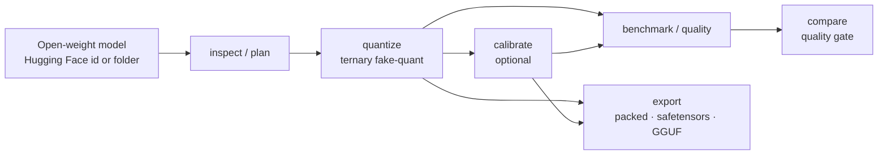

<div class="ot-hero" markdown>
<div markdown>

# OpenTernary

<p class="ot-tagline">Open-source tooling for turning open-weight language models into <strong>ternary</strong> models, with weights restricted to <span class="ot-trit minus">−1</span>, <span class="ot-trit zero">0</span> and <span class="ot-trit plus">+1</span>, and for measuring honestly what that costs.</p>

[Get started](getting-started/index.md){ .md-button .md-button--primary }
[Try it in 5 minutes](getting-started/first-run.md){ .md-button }

</div>

</div>

```bash
uv tool install openternary --python 3.12   # the command, available everywhere
openternary setup                           # detect your GPU, install a matching PyTorch
openternary                                 # open the full-screen interface
```

!!! warning "Research software"

    OpenTernary is an **alpha** research toolkit (version 0.1.0a2). It can inspect, quantize, calibrate,
    evaluate and export models, and it records everything it does. **No ternary model produced with it
    has passed its quality gate yet.** Expect quantized models to be slow and much worse than the original.
    See [Status](project/status.md) for exactly what has and has not been verified.

## What it does

<div class="grid cards" markdown>

-   :material-magnify: **Inspect and plan**

    ---

    List the tensors that can be quantized, from file headers alone, with no download or GPU needed. Then preview
    a quantization plan before anything is written.

    [:octicons-arrow-right-24: Inspect and plan](guides/inspect-and-plan.md)

-   :material-numeric-3-box-outline: **Quantize to ternary**

    ---

    Convert every linear layer to `{-1, 0, +1}` codes with per-tensor or per-group scales. Output is a
    reloadable *fake-quant* snapshot, written atomically.

    [:octicons-arrow-right-24: Quantize](guides/quantize.md)

-   :material-tune-variant: **Calibrate**

    ---

    Recover quality layer by layer: learn scales, thresholds or soft-to-hard assignments against the original
    model's activations. Supports checkpoints and resume.

    [:octicons-arrow-right-24: Calibrate](guides/calibrate.md)

-   :material-scale-balance: **Evaluate and compare**

    ---

    Run a fixed smoke benchmark and frozen English/Japanese quality sets. Compare runs under identical conditions
    against a preregistered quality gate.

    [:octicons-arrow-right-24: Evaluate and compare](guides/evaluate-and-compare.md)

-   :material-package-variant-closed: **Export**

    ---

    Pack weights to 2 bits each, restore them byte for byte, or bridge to GGUF through llama.cpp's
    converter. Every artifact carries a manifest with hashes for all its files.

    [:octicons-arrow-right-24: Export](guides/export.md)

-   :material-console: **CLI, TUI and Python**

    ---

    Every command has a versioned `--json` result, progress events and stable exit codes. The TUI runs the same
    commands as background jobs, and a Python API exposes the same services.

    [:octicons-arrow-right-24: Automation](guides/automation.md)

</div>

## How it fits together



Each step writes a **run directory** that records the config, environment, model revision and results, so
another person can see exactly what produced a number. [Runs and evidence](concepts/runs-and-evidence.md)
explains how to read one.

## Principles

**Measure before optimizing.** Every conversion is compared against a fixed baseline, under the same protocol.

**Evidence over claims.** A finished command (`execution: completed`) is never reported as a quality pass. Unmeasured
memory or speed is `null`, not 0. Quality gates are fixed before the experiment, not tuned to it.

**Quality per byte, not bit-count vanity.** Keeping sensitive layers at higher precision is allowed when it
preserves much more capability.

**Japanese is a first-class metric.** The frozen quality sets measure English and Japanese separately.

## Where to go next

| You want to… | Read |
|---|---|
| Install OpenTernary and PyTorch for your GPU | [Installation](getting-started/installation.md) |
| See the whole pipeline work on a laptop, offline | [Your first run](getting-started/first-run.md) |
| Understand what "ternary" means and what it costs | [Ternary quantization](concepts/ternary-quantization.md) |
| Look up a flag | [CLI reference](reference/cli.md) |
| Script OpenTernary or run it in CI | [Automation](guides/automation.md) |
| Know what is proven and what is not | [Status](project/status.md) |
