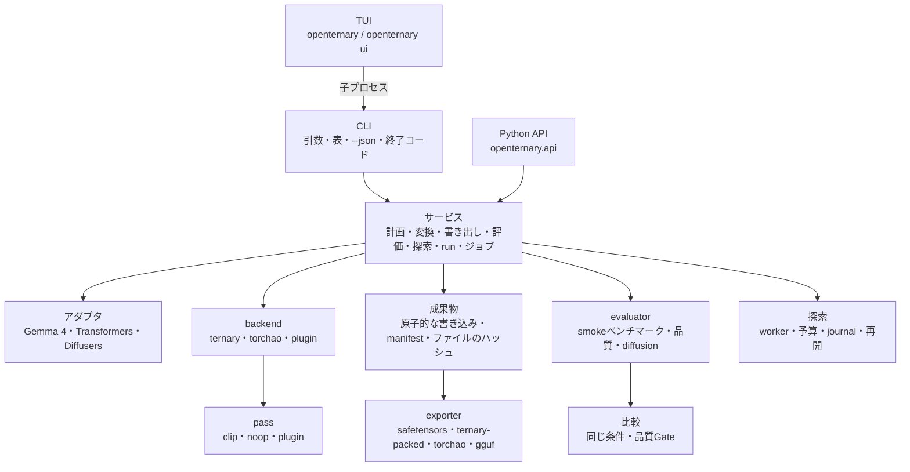

# アーキテクチャ

OpenTernaryは3つの関心事を独立させ、どれかを変えても他を書き直さずに済むようにしています:

```text
モデルの構造   ×   量子化の方式      ×   評価・書き出し
 （アダプタ）     （backend・pass）     （evaluator・exporter）
```

モデルを追加するのに新しい量子化の数式が要ったり、量子化の方式を追加するのにモデルごとのコードが要ったりしない
ようにするためです。

## 層の構成 {#layers}



| 層 | パッケージ | 役割 |
|---|---|---|
| **CLI** | `openternary.cli` | 引数を解釈し、表または1つのJSONを出し、エラーを終了コードに対応付けます。独自の処理は持ちません。 |
| **TUI** | `openternary.ui.app` | CLIの定義からフォームを作り、すべてのジョブを子プロセスの `python -m openternary …` として実行します。 |
| **Python API** | `openternary.api` | 同じサービスへの、安定したバージョン1の入口です。importしてもPyTorchは読み込みません。 |
| **サービス** | `openternary.services` | 計画・変換・書き出し・評価・探索・runの検出・ジョブの管理・PyTorchの環境構築・更新。CLIとAPIが共有します。 |
| **アダプタ** | `openternary.adapters` | モデルやpipelineのcomponentを判別し、各テンソル（量子化の対象か、役割は何か）を分類し、実行時に読み込みます。分からない重みを対象とみなすことはありません。 |
| **backend** | `openternary.backends` | 量子化の方式。`ternary`（OpenTernary独自の数式）か `torchao`（TorchAO 0.18.0）。 |
| **量子化の中核** | `openternary.quant` | 数式: AbsMean・グループ化・閾値・softな符号・2bitのpacked化・ビットの集計・サイズ上限付きのshard書き出し。 |
| **校正** | `openternary.calibration` | 活性値の記録、層ごとの最適化、チェックポイント、復旧、preflight。 |
| **評価** | `openternary.benchmark` | smokeのsuite、品質データセットとパープレキシティ、受入のGate。 |
| **実験** | `openternary.experiment` | 実行フォルダ、メタデータ、runのロック、runの比較。 |
| **書き出し** | `openternary.export` | packed形式、GGUFへの橋渡し。 |

## 知っておくとよい設計の判断 {#design-decisions-worth-knowing}

**既定はヘッダだけ。** `inspect` と `plan` は、safetensorsのヘッダと `config.json` だけを読みます。PyTorchも
GPUも、重みのダウンロードも要りません。ビットの集計のコードも、同じ理由で標準ライブラリだけを使います。

**書き込み時のメモリに上限がある。** 量子化したsnapshotは、テンソルを1つずつ、最大512MiBのshardに書きます。
次のテンソルを入れるとあふれる場合は、入れる*前に*shardを書き出し、それより大きいテンソルは単独のshardにします。
メモリの使用量は、モデルの大きさではなく、最大のテンソルとshard 1つ分で決まります。Hugging Faceのキャッシュの
シンボリックリンクは実体に置き換えるので、snapshotはそれだけで完結します。

**原子的な成果物。** 書き出しはすべて、一意な一時フォルダに書いて検査してから、最終的な名前に移します。既存の
成果物を上書きすることはありません。manifest（`openternary-manifest.json`）には、形式・schema・来歴・設定・
backend・アダプタ・pass・コードのハッシュ・全ファイルのSHA-256を記録し、書き出しを重ねても引き継ぎます。

**内容のfingerprint。** snapshotの同一性は、テンソルの名前・dtype・形・生のバイトを並べたもののハッシュです。
ファイルのハッシュも記録しますが、内容が同じsnapshotは、shardの分け方が違っても同じfingerprintになります。

**デバイスに正直。** snapshotの変換はCPUで行います。`quantize` に `--device cuda` を渡すと、黙ってCPUに
切り替えるのではなく拒否します。GPUでの評価が失敗したときに、CPUの結果で置き換えることもありません。

**pluginは選んだときだけ読み込む。** pluginの一覧（`openternary plugins`・`backends list`）はentry pointの情報を
読むだけで、pluginのコードはimportしません。名前を指定して選んだときに初めてimportします。
[plugin](../reference/plugins.md)を参照してください。

**遅延import。** `--json` の処理はTUIのライブラリを読み込まず、本体だけの導入ではPyTorchを読み込まないので、
CLIは速く起動し、最小限の環境でも動きます。

## さらに読む {#further-reading}

保守している設計の文書はリポジトリにあります（英語・日本語が混在しています）:

- [ARCHITECTURE.md](https://github.com/ELRdn/OpenTernary/blob/main/ARCHITECTURE.md): データの流れ、アダプタと
  量子化器の契約、テンソルの表現
- [docs/TUI_DESIGN.md](https://github.com/ELRdn/OpenTernary/blob/main/docs/TUI_DESIGN.md): TUIの設計判断（D1〜D24）
- [PROJECT_SPEC.md](https://github.com/ELRdn/OpenTernary/blob/main/PROJECT_SPEC.md): 目標と要件
