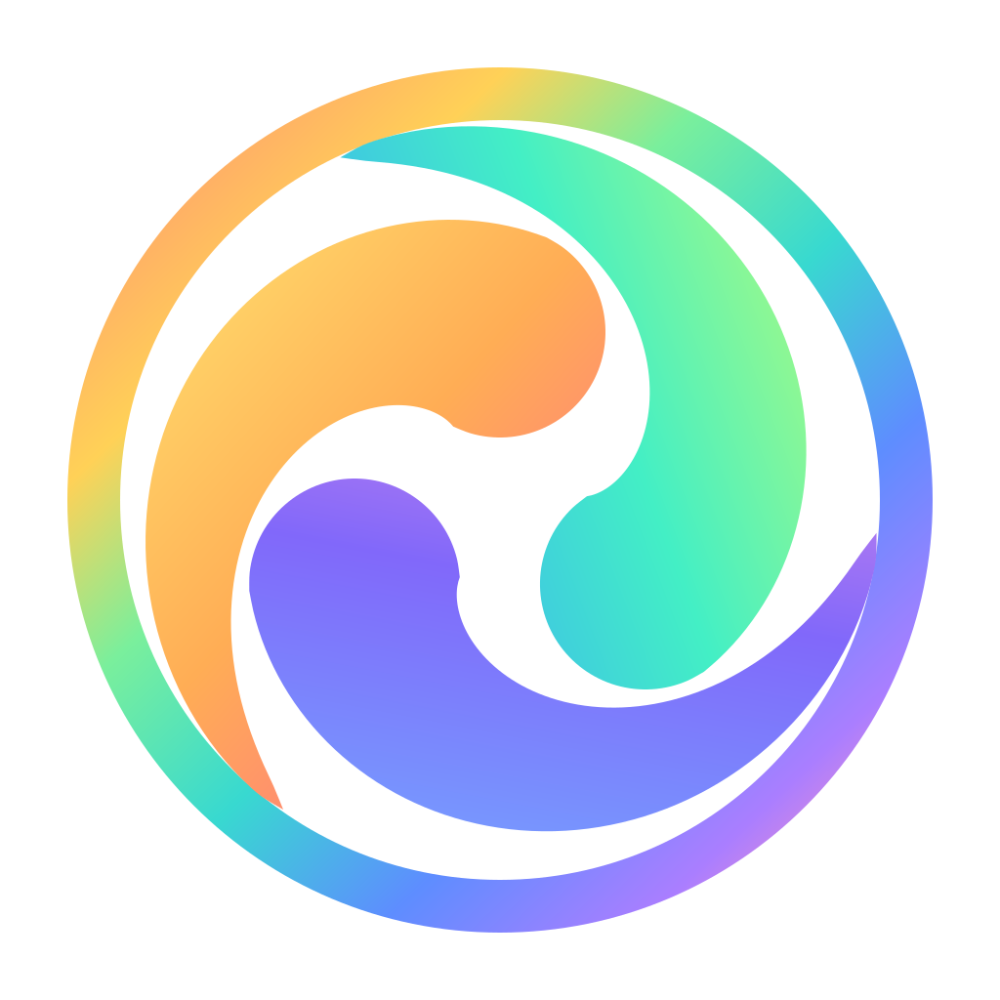
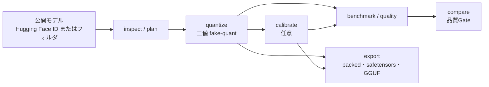

<div class="ot-hero" markdown>
<div markdown>

# OpenTernary

<p class="ot-tagline">公開されている言語モデルの重みを <span class="ot-trit minus">−1</span>・<span class="ot-trit zero">0</span>・<span class="ot-trit plus">+1</span> の3値に制限した<strong>三値モデル</strong>に変換し、それで何が失われるかを正直に測るためのオープンソースのツールです。</p>

[はじめる](getting-started/index.md){ .md-button .md-button--primary }
[5分で試す](getting-started/first-run.md){ .md-button }

</div>

</div>

```bash
uv tool install openternary --python 3.12   # どこからでも使えるコマンドとして入れる
openternary setup                           # GPUを検出し、合うPyTorchを入れる
openternary                                 # 全画面のインターフェースを開く
```

!!! warning "研究用のソフトウェアです"

    OpenTernaryは**アルファ版**の研究ツールキットです（バージョン 0.1.0a2）。モデルの調査・量子化・校正・評価・
    書き出しができ、行ったことはすべて記録されます。ただし、**このツールで作った三値モデルで、品質の受入条件を
    満たしたものはまだありません。** 量子化したモデルは遅く、元のモデルよりかなり性能が落ちると考えてください。
    何が検証済みで何が未検証かは[現在の状況](project/status.md)にまとめています。

## できること {#what-it-does}

<div class="grid cards" markdown>

-   :material-magnify: **調査と計画**

    ---

    量子化できるテンソルを、ファイルのヘッダだけから一覧します。ダウンロードもGPUも不要です。何かを書き込む前に、
    量子化の計画を確認できます。

    [:octicons-arrow-right-24: 調査と計画](guides/inspect-and-plan.md)

-   :material-numeric-3-box-outline: **三値に量子化**

    ---

    すべての線形層を `{-1, 0, +1}` の符号とテンソル単位またはグループ単位のscaleに変換します。出力は読み込み直せる
    *fake-quant* のsnapshotで、原子的に書き込まれます。

    [:octicons-arrow-right-24: 量子化](guides/quantize.md)

-   :material-tune-variant: **校正**

    ---

    元のモデルの活性値に合わせて、層ごとにscale・閾値・soft-to-hardの割り当てを学習し、品質の回復を試みます。
    チェックポイントと再開に対応しています。

    [:octicons-arrow-right-24: 校正](guides/calibrate.md)

-   :material-scale-balance: **評価と比較**

    ---

    固定のsmokeベンチマークと、英語・日本語の固定した品質データで測定します。同じ条件で測ったrunどうしを、
    事前に決めた品質Gateで比較します。

    [:octicons-arrow-right-24: 評価と比較](guides/evaluate-and-compare.md)

-   :material-package-variant-closed: **書き出し**

    ---

    重みを1つ2bitに詰め、バイト単位で元に戻し、llama.cppのconverterを通してGGUFにも変換できます。成果物には
    全ファイルのハッシュを記したmanifestが付きます。

    [:octicons-arrow-right-24: 書き出し](guides/export.md)

-   :material-console: **CLI・TUI・Python**

    ---

    すべてのコマンドに、バージョン付きの `--json` 結果、進捗イベント、決まった終了コードがあります。TUIは同じ
    コマンドをバックグラウンドのジョブとして動かし、Python APIからも同じ機能を使えます。

    [:octicons-arrow-right-24: 自動化](guides/automation.md)

</div>

## 全体の流れ {#how-it-fits-together}



各ステップは**実行フォルダ（run）**を作り、設定・環境・モデルのrevision・結果を記録します。ある数字がどうやって
出たのかを、他の人も正確にたどれます。読み方は[実行結果と証拠](concepts/runs-and-evidence.md)で説明しています。

## 原則 {#principles}

**最適化の前に測る。** すべての変換を、固定した基準と同じ手順で比較します。

**主張より証拠。** コマンドが最後まで動いたこと（`execution: completed`）を、品質の合格として扱うことはありません。
測っていないメモリや速度は0ではなく `null` です。品質Gateは実験の前に決め、実験に合わせて変えません。

**ビット数の見栄より、1バイトあたりの品質。** 重要な層を高い精度のまま残すことで能力を大きく保てるなら、それを認めます。

**日本語を一級の指標に。** 固定した品質データは、英語と日本語を別々に測ります。

## 次に読むもの {#where-to-go-next}

| やりたいこと | 読むページ |
|---|---|
| OpenTernaryとGPUに合うPyTorchを入れる | [インストール](getting-started/installation.md) |
| ノートPCで、オフラインのまま全工程を動かしてみる | [はじめての実行](getting-started/first-run.md) |
| 「三値」の意味と、その代償を理解する | [三値量子化](concepts/ternary-quantization.md) |
| オプションを調べる | [CLIリファレンス](reference/cli.md) |
| スクリプトやCIから使う | [自動化](guides/automation.md) |
| 何が証明済みで何がそうでないかを知る | [現在の状況](project/status.md) |
